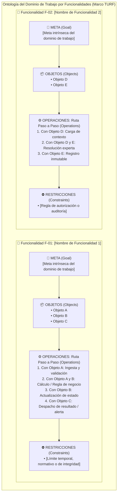

# 🧠 Marco TURF: Ingeniería Cognitiva, Ontología del Dominio y Usabilidad
> **Metodología:** Marco TURF (*Task, User, Representation, Function*) desarrollado por el Dr. Jiajie Zhang (*Better EHR* / McWilliams School of Biomedical Informatics), respaldado por la ONC y el NIH para el diseño de sistemas complejos, análisis de dominio de trabajo y erradicación de dificultad extrínseca.

---

<!-- GUÍA PARA EL LLM:
El marco TURF define formalmente la USABILIDAD como:
"La capacidad de un sistema para que ciertos usuarios (U) completen metas en un dominio del trabajo específico (F) a través de secuencias de tareas (T) mediante representaciones visuales adecuadas (R)".

Pilares conceptuales innegociables al completar esta plantilla:
1. 'F' (Función & Dominio del Trabajo): Representa el entorno conceptual y operativo donde ocurren las actividades del negocio/salud, independiente de cualquier software específico.
2. Complejidad Intrínseca vs. Dificultad Extrínseca:
   - Complejidad Intrínseca: Es la naturaleza real del dominio (normas clínicas, regulaciones, patologías, criterios expertos). NO se puede ni debe simplificar artificialmente.
   - Dificultad Extrínseca: Es el estorbo añadido por mal software (menús confusos, clics excesivos, pasos parásitos). El objetivo es ELIMINARLA por completo.
3. Dimensiones de Evaluación de Usabilidad en TURF:
   - Utilidad (Useful / Usefulness): Mide si las funciones del sistema corresponden y cubren las necesidades reales de las metas del dominio del trabajo (evitando sobre-saturación o funciones huérfanas irrelevantes).
   - Usabilidad (Usable / Usableness): Mide con qué facilidad los usuarios pueden realizar sus tareas usando representaciones visuales adecuadas (R) para alcanzar esas metas de trabajo.
   - Satisfacción (Satisfying): Un sistema es satisfactorio de usar si los usuarios tienen una buena impresión subjetiva de cuán útil, usable y agradable resulta el sistema ("A system is satisfying to use if the users have good subjective impression of how useful, usable, and likable the system is").
-->

## 📌 Metadatos del Sistema
- **Nombre del Producto / Sistema:** `[Nombre del sistema o módulo]`
- **Dominio / Vertical:** `[ej. Salud / Gobernanza Docencia-Servicio / Fintech / Logística / SaaS B2B / etc.]`
- **Problema de Negocio / Solución Priorizada:** `[Referencia al Canvas o problema principal a resolver]`
- **Fecha & Versión:** `[YYYY-MM-DD • Versión 1.0-draft]`

---

## 👤 1. Análisis de Usuarios (U - User Analysis)

<!-- GUÍA PARA EL LLM:
Identifica entre 2 y 5 roles de usuario clave que interactúan con el sistema.
No te limites a roles genéricos como 'Admin' o 'Usuario'. Describe su contexto real de operación:
- ¿Trabaja bajo presión temporal? (ej. cajero en hora pico, despachador de logística, médico en urgencias).
- ¿Qué experiencia previa tiene con sistemas similares?
- ¿Cuáles son sus principales limitaciones cognitivas en el momento de uso? (fatiga, interrupciones continuas, sobrecarga de información).
-->

| Perfil / Rol de Usuario | Nivel de Pericia & Dominio | Contexto de Uso & Restricciones Cognitivas | Meta Principal en la Sesión |
|---|---|---|---|
| **`[Rol Principal: Operador / Especialista]`** | *[ej. Experto en el dominio de negocio; uso medio-alto de software.]* | *[ej. Tiempo limitado por transacción (<2 min); altas interrupciones; alta carga mental; riesgo de fatiga de decisiones.]* | *[ej. Resolver la solicitud del cliente o ejecutar la decisión crítica con máxima precisión y respaldo explicable.]* |
| **`[Rol Secundario: Ejecutor / Soporte]`** | *[ej. Conocimiento operativo amplio; ejecución de tareas rutinarias o atención de incidentes.]* | *[ej. Turnos largos; trabajo con múltiples pestañas abiertas simultáneamente; requiere flujos guiados sin ambigüedades.]* | *[ej. Identificar bloqueos rápidamente, aplicar acciones estándar y escalar anomalías complejas.]* |
| **`[Rol Supervisor / Auditor / Lead]`** | *[ej. Experto analítico; supervisión de calidad, cumplimiento y métricas agregadas.]* | *[ej. Trabajo en escritorio; análisis retrospectivo; enfocado en detección de patrones, auditoría y optimización.]* | *[ej. Validar cumplimiento de políticas, evaluar desviaciones y autorizar excepciones justificadas.]* |
| **`[Rol Automatizado / Agente / Servicio]`** *(Opcional)* | *[ej. Agente IA o Worker en background con reglas o modelos ML.]* | *[ej. Ejecución desasistida o semi-asistida; requiere contratos estrictos y logs deterministas de auditoría.]* | *[ej. Pre-procesar información, calcular scores y generar propuestas para revisión humana.]* |

---

## 🏛️ 2. Ontología del Dominio de Trabajo por Funcionalidades (F - Function Analysis)

> ### 📖 Fundamento Teórico: El Dominio del Trabajo (*Work Domain*)
> En la metodología TURF (*Better EHR*), el **Dominio del Trabajo** es el entorno conceptual y operativo donde ocurren las actividades reales del usuario (ej. la práctica médica, la docencia-servicio, la gestión de riesgo), con total independencia de cualquier software específico.
> - **Si una funcionalidad pertenece al dominio del trabajo:** Responde a la misión, reglas intrínsecas o necesidades reales del usuario. Aporta **Utilidad (*Useful*)**.
> - **Si una funcionalidad NO pertenece al dominio del trabajo:** Pertenece al "mundo del software" sin aportar a la meta real, introduciendo dificultad extrínseca y ruido cognitivo.

<!-- GUÍA PARA EL LLM:
En el análisis funcional (F) del marco TURF, el sistema NO se modela como una bolsa desordenada de conceptos abstractos.
Se modela ESTRUCTURADAMENTE por cada una de sus FUNCIONALIDADES (F-01, F-02, F-03...).

Para CADA Funcionalidad del sistema:
1. Pertenencia al Dominio del Trabajo: Marcar en el checkbox únicamente si la funcionalidad pertenece [x] o no [ ] al dominio del trabajo real.
2. Meta (Goal): Cada funcionalidad persigue UNA meta clara en el dominio (¿qué estado final del dominio busca alcanzar?).
3. Objetos (Objects): Las entidades conceptuales con las que opera esa meta (una meta suele involucrar varios objetos).
4. Operaciones (Operations - Ruta Paso a Paso): La secuencia determinista de acciones que se ejecutan paso a paso con cada uno de esos objetos para transformar su estado y cumplir la meta.
5. Restricciones (Constraints): Las reglas inmutables, normativas legales, límites de tiempo o invariantes aplicables a esa funcionalidad.
-->

### Detalle Estructurado por Funcionalidad:

---

### 🔹 F-01: `[Nombre de la Funcionalidad 1 — ej. Evaluación Automática de Riesgo y Detección de Fraude]`

- **¿Pertenece al Dominio del Trabajo?**
  - [x] **Sí** (Pertenece al Dominio del Trabajo)
  - [ ] **No** (No pertenece al Dominio del Trabajo)

- **🎯 Meta de la Funcionalidad (Goal):**  
  `[Define la meta única y medible que persigue esta funcionalidad en el dominio. Ej. 'Determinar con precisión en tiempo real si una transacción entrante presenta patrones sospechosos de fraude antes de comprometer fondos.']`

- **📦 Objetos del Dominio Involucrados (Objects & Attributes):**  
  <!-- Una meta puede interactuar con múltiples objetos o entidades del dominio -->
  1. `[Objeto A: TransaccionEntrante (id, cliente_id, monto, moneda, geolocalizacion, timestamp)]`  
  2. `[Objeto B: PerfilHistoricoCliente (id, score_previo, compras_habituales, bloqueos_previos)]`  
  3. `[Objeto C: DictamenDeRiesgo (id, transaccion_id, score_calculado, nivel_alerta, factores_explicativos, estado)]`  

- **⚙️ Operaciones & Ruta Paso a Paso con los Objetos (Operations Path):**  
  <!-- GUÍA: Describe la secuencia exacta de transformaciones aplicadas sobre cada objeto desde el estado inicial hasta cumplir la meta -->
  1. **Paso 1 (con TransaccionEntrante):** Ingerir el payload entrante, verificar firma de autenticidad y validar tipos y rangos de datos requeridos.
  2. **Paso 2 (con TransaccionEntrante y PerfilHistoricoCliente):** Consultar el historial del cliente y cruzar métricas de comportamiento (volumen, frecuencia de transacciones y geolocalización).
  3. **Paso 3 (con DictamenDeRiesgo):** Ejecutar el motor de scoring algorítmico y evaluar umbrales de riesgo; generar el dictamen con los factores causales explicables.
  4. **Paso 4 (con DictamenDeRiesgo y TransaccionEntrante):** Si el score supera el umbral crítico, marcar la transacción como 'EN_REVISION' y persistir el dictamen en el registro inmutable de auditoría.
  5. **Paso 5 (con DictamenDeRiesgo):** Despachar la notificación contextual al operador o servicio consumidor con el resultado y acción sugerida.

- **⛔ Restricciones e Invariantes (Constraints & Invariants):**  
  - *Restricción Temporal:* La ruta completa de operaciones no debe exceder 350 ms de latencia.
  - *Restricción de Integridad:* No se evaluarán transacciones con datos requeridos incompletos o inconsistentes.
  - *Restricción de Privacidad:* Los datos protegidos o sensibles deben ser anonimizados/tokenizados antes de cualquier operación.

---

### 🔹 F-02: `[Nombre de la Funcionalidad 2 — ej. Resolución Manual y Mitigación de Alertas Complejas]`

- **¿Pertenece al Dominio del Trabajo?**
  - [x] **Sí** (Pertenece al Dominio del Trabajo)
  - [ ] **No** (No pertenece al Dominio del Trabajo)

- **🎯 Meta de la Funcionalidad (Goal):**  
  `[ej. 'Permitir al analista especialista revisar el dictamen de riesgo, evaluar evidencia contextual y dictaminar la aprobación o bloqueo del caso en menos de 60 segundos.']`

- **📦 Objetos del Dominio Involucrados (Objects & Attributes):**  
  1. `[Objeto A: CasoEnRevision (id, transaccion_id, dictamen_id, analista_asignado, timestamp_apertura)]`  
  2. `[Objeto B: EvidenciaContextual (documentos_adjuntos, historial_ip, contacto_cliente)]`  
  3. `[Objeto C: ResolucionFinal (caso_id, decision [APROBADO/BLOQUEADO], motivo_codigo, justificacion_texto, firma_operador)]`  

- **⚙️ Operaciones & Ruta Paso a Paso con los Objetos (Operations Path):**  
  1. **Paso 1 (con CasoEnRevision):** Abrir el caso en el panel del analista bloqueando ediciones concurrentes por otros usuarios.
  2. **Paso 2 (con CasoEnRevision y EvidenciaContextual):** Desplegar de forma jerárquica los factores causales principales que originaron la sospecha junto con la evidencia vinculada.
  3. **Paso 3 (con ResolucionFinal):** Capturar la decisión del analista en un solo clic, exigiendo justificación tipificada si se contradice la sugerencia del sistema.
  4. **Paso 4 (con ResolucionFinal y CasoEnRevision):** Persistir la resolución inmutablemente, liberar el bloqueo de concurrencia y despachar la orden downstream.

- **⛔ Restricciones e Invariantes (Constraints & Invariants):**  
  - *Restricción de Autorización:* Únicamente analistas con perfil de especialista o supervisor pueden emitir resoluciones.
  - *Restricción de Explicabilidad:* Queda prohibido cerrar un caso en revisión sin seleccionar un motivo tipificado de la taxonomía oficial.

---

### 🔹 F-03: `[Nombre de la Funcionalidad 3 — ej. Auditoría de Trazabilidad y Reporte de Cumplimiento]`

- **¿Pertenece al Dominio del Trabajo?**
  - [x] **Sí** (Pertenece al Dominio del Trabajo)
  - [ ] **No** (No pertenece al Dominio del Trabajo)

- **🎯 Meta de la Funcionalidad (Goal):**  
  `[ej. 'Consolidar el registro inmutable de transacciones, dictámenes y resoluciones para emitir reportes de cumplimiento normativo ante entes de control sin reprocesos.']`

- **📦 Objetos del Dominio Involucrados (Objects & Attributes):**  
  1. `[Objeto A: RegistroDeAuditoria (id, timestamp, entidad_afectada, usuario_id, accion_ejecutada, hash_integridad)]`  
  2. `[Objeto B: ReporteNormativo (periodo, entidad_reguladora, total_evaluadas, total_bloqueadas, metricas_precision)]`  

- **⚙️ Operaciones & Ruta Paso a Paso con los Objetos (Operations Path):**  
  1. **Paso 1 (con RegistroDeAuditoria):** Consultar los registros append-only verificando la cadena criptográfica de integridad.
  2. **Paso 2 (con RegistroDeAuditoria y ReporteNormativo):** Agregar métricas de cumplimiento y clasificar por tipo de decisión y causales.
  3. **Paso 3 (con ReporteNormativo):** Generar el documento consolidado exportable garantizando cero alteración de datos de origen.

- **⛔ Restricciones e Invariantes (Constraints & Invariants):**  
  - *Restricción de Inmutabilidad:* Los registros de auditoría no pueden ser editados ni eliminados bajo ninguna circunstancia.
  - *Restricción de Acceso:* Acceso restringido exclusivamente a roles de Auditoría y Compliance.

---

## 🗂️ 3. Matriz de Usuarios vs. Funcionalidades (U-Fu Matrix)

<!-- GUÍA PARA EL LLM:
Cruza los roles de usuario definidos en la sección 1 con las funcionalidades formalizadas en la sección 2 (F-01, F-02, F-03...).
Indica claramente los permisos y nivel de interacción mediante la siguiente convención:
- ✅ Ejecuta / Modifica (Acceso pleno a la ruta operativa)
- 👁️ Solo Lectura / Consulta de objetos y resultados
- ⚠️ Restringido / Requiere Aprobación o Justificación
- 💡 Sugerir / Pre-cargar propuesta asistida
- ❌ No Permitido / Sin Acceso
-->

| Rol de Usuario | F-01: [Nombre F-01] | F-02: [Nombre F-02] | F-03: [Nombre F-03] | F-04: [Nombre F-04] |
|---|:---:|:---:|:---:|:---:|
| **`[Rol Principal / Especialista]`** | ✅ (Automático/Supervisado) | ✅ (Resolución plena) | 👁️ (Consulta de auditoría) | ⚠️ (Con justificación) |
| **`[Rol Secundario / Operador]`** | 👁️ (Consulta de resultado) | ⚠️ (Sujeto a validación) | ❌ | 💡 (Sugerir propuesta) |
| **`[Rol Supervisor / Lead]`** | ✅ (Supervisión global) | ✅ (Aprobación escalada) | ✅ (Extracción de reportes) | ✅ (Autorización) |
| **`[Rol Auditor / Compliance]`** | 👁️ (Logs anonimizados) | 👁️ (Historial de decisiones) | ✅ (Extracción oficial) | ❌ |

---

## 👁️ 4. Principios de Representación (R) y Tarea (T)

<!-- GUÍA PARA EL LLM:
Define cómo se presentará la información (R) y cómo será el flujo de interacción óptimo (T) para erradicar la dificultad extrínseca y las tareas parásitas.
-->

### 📐 Principios de Representación (R - Information Representation)
- **Representación Isomórfica y Jerarquía Visual:**  
  `[¿Cómo se muestra la información para reflejar el modelo mental del usuario? Ej. 'Usar códigos cromáticos semióticos estandarizados (Verde = Normal, Ámbar = Atención requerida, Rojo = Acción urgente requerida) sin tapar la pantalla principal de trabajo.']`
- **Reducción de Carga Cognitiva y Chunking:**  
  `[¿Cómo se evita abrumar al usuario? Ej. 'Mostrar de inmediato los 3 factores causales principales que motivan la alerta/decisión, ocultando el detalle técnico en un menú desplegable de 1 clic.']`
- **Explicabilidad en Contexto:**  
  `[La salida del sistema debe ser interpretable inmediatamente: mostrar la regla o peso probabilístico que originó el resultado, permitiendo al usuario tomar una decisión informada en segundos.]`

### ⚡ Flujo de Tarea Óptimo (T - Task Optimization & Erradicación de Dificultad Extrínseca)
- **Diagnóstico del Flujo Actual (o sin sistema):**  
  `[Describe la dificultad extrínseca y fricción previa: ej. 'El usuario debía consultar 3 pantallas distintas, copiar manualmente un código, abrir otra herramienta para calcular y luego registrar en un formulario (7 clics, 4 minutos).']`
- **Flujo Optimizado Rediseñado:**  
  `[Describe el flujo simplificado: ej. 'La evaluación se ejecuta en segundo plano al cargar el contexto; si hay alerta, aparece embebida en la misma pantalla con la acción sugerida ejecutable en 1 solo clic (1 pantalla, 2 clics, <10 segundos).']`
- **Manejo de Desestimaciones o Excepciones:**  
  `[Si el usuario decide no seguir la recomendación del sistema, el flujo debe permitir anularla con un mínimo de fricción (ej. selector rápido de motivos comunes pre-cargados + campo opcional de texto).]`

---

## ✅ Checklist de Calidad para el LLM (Autovalidación)
Antes de dar por completado este documento, verifica:
- [ ] Los perfiles de usuario (U) incluyen sus limitaciones cognitivas reales, contexto de uso y tiempo disponible.
- [ ] Se distingue con precisión la Complejidad Intrínseca (del dominio) de la Dificultad Extrínseca (del software).
- [ ] Se consideran las 3 dimensiones de usabilidad en TURF: Utilidad (*Useful*), Usabilidad (*Usable*) y Satisfacción (*Satisfying*).
- [ ] Cada funcionalidad (F-01, F-02, F-03...) tiene su propia sección detallada e independiente.
- [ ] Cada funcionalidad tiene marcado el checkbox únicamente de si pertenece o no al Dominio del Trabajo (`Sí` / `No`).
- [ ] Para cada funcionalidad existe una sola meta (Goal) clara y bien delimitada en el dominio.
- [ ] Se identifican los objetos del dominio específicos involucrados en esa funcionalidad con sus atributos clave.
- [ ] Las operaciones describen la ruta secuencial paso a paso interactuando con cada uno de esos objetos.
- [ ] Se documentan las restricciones e invariantes específicas aplicables a cada funcionalidad.
- [ ] La matriz U-Fu mapea los roles contra cada funcionalidad individual (F-01, F-02, etc.) con códigos de acceso inequívocos.
- [ ] La sección de Representación (R) detalla cómo se evita la sobrecarga cognitiva para los objetos principales.
- [ ] La sección de Tarea (T) cuantifica la reducción de pasos, fricción y erradicación de dificultad extrínseca.
