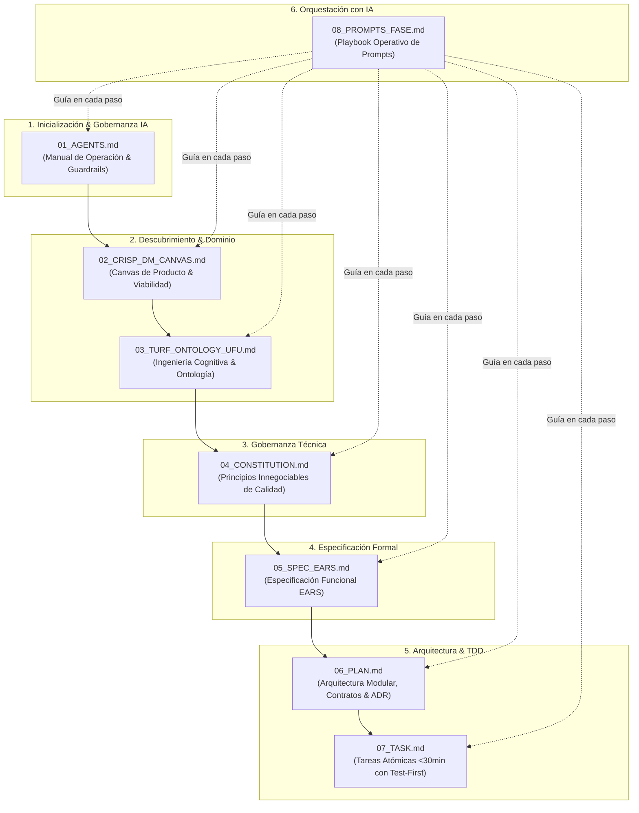

# 🧭 Suite de Plantillas-Guía: Spec-Driven Development (SDD)
> **Propósito:** Colección de plantillas estandarizadas e instructivas para guiar a desarrolladores y modelos de lenguaje (LLMs / Agentes de IA) a lo largo del ciclo completo de desarrollo guiado por especificaciones, aplicable a **cualquier producto de software o sistema de datos/IA**.

---

## 🗺️ Mapa del Flujo y Secuencia Metodológica

---

## 📚 Catálogo de Plantillas y sus Metodologías

| # | Archivo | Metodología Base | Artefacto Generado en el Repo | Propósito Principal |
|---|---|---|---|---|
| **01** | [`01_AGENTS.md`](./01_AGENTS.md) | Agentic Pair Programming Guardrails | `AGENTS.md` (o `CLAUDE.md`) | Instrucciones operativas iniciales para asistentes de IA: comandos de test/lint, estilo de código y reglas de disciplina estricta. |
| **02** | [`02_CRISP_DM_CANVAS.md`](./02_CRISP_DM_CANVAS.md) | CRISP-DM + Lean AI + HMW | `docs/canvas.md` | Alinear la visión de negocio, justificar el impacto vs. factibilidad y definir KPIs medibles antes de programar. |
| **03** | [`03_TURF_ONTOLOGY_UFU.md`](./03_TURF_ONTOLOGY_UFU.md) | TURF Framework (Dr. J. Zhang) | `docs/domain_ontology.md` | Modelar usuarios, la ontología funcional de trabajo (Metas, Objetos, Operaciones, Restricciones), matriz de permisos U-Fu y erradicar tareas parásitas. |
| **04** | [`04_CONSTITUTION.md`](./04_CONSTITUTION.md) | Reglas de Arquitectura & Guardrails | `docs/constitution.md` | Establecer entre 6 y 8 principios innegociables (stack, tipado estricto, tests >=90%, privacidad, cero vibe coding). |
| **05** | [`05_SPEC_EARS.md`](./05_SPEC_EARS.md) | EARS (*Easy Approach to Requirements Syntax*) | `specs/<id>-<nombre>/spec.md` | Documentar el QUÉ y el POR QUÉ formalmente con RF numerados bajo los 5 patrones EARS, casos límite y Definition of Done. |
| **06** | [`06_PLAN.md`](./06_PLAN.md) | ADR + Modular Design | `specs/<id>/plan.md` | Diseñar la arquitectura modular, contratos tipados, decisiones técnicas justificadas (ADR) y estrategia de tests. |
| **07** | [`07_TASK.md`](./07_TASK.md) | Desglose TDD Atómico (<30 min) | `specs/<id>/tasks.md` | Descomponer el plan en una lista estrictamente secuencial de tareas atómicas con enfoque Test-First y comandos deterministas de verificación. |
| **08** | [`08_PROMPTS_FASE.md`](./08_PROMPTS_FASE.md) | Prompt Engineering Determinista | Cheatsheet de interacción | Prompts exactos con guardrails para guiar al modelo paso a paso en las fases del desarrollo. |

---

## 💡 Cómo Usar estas Plantillas con un LLM

1. **Estructura "Plantilla-Guía":**  
   Cada archivo contiene bloques especiales `<!-- GUÍA PARA EL LLM: ... -->`. Estos bloques le indican al modelo exactamente:
   - Cómo debe razonar.
   - Qué preguntas debe hacer antes de rellenar información.
   - Qué nivel de formalismo y granularidad utilizar.
   - Qué vicios evitar (alucinaciones, código prematuro, ambigüedad).
2. **Independencia de Dominio:**  
   Todas las plantillas han sido despojadas de referencias exclusivas a un solo sector y ahora usan placeholders estándar `[Nombre de Entidad]`, `[Métrica de Negocio]` y ejemplos multivertical (Fintech, Salud/EHR, Logística, SaaS B2B, etc.).
3. **Flujo de Ejecución Recomendado:**  
   Sigue el playbook de prompts en [`08_PROMPTS_FASE.md`](./08_PROMPTS_FASE.md) para ejecutar cada fase con tu herramienta de IA preferida (Claude Code, Antigravity, Cursor, etc.).
